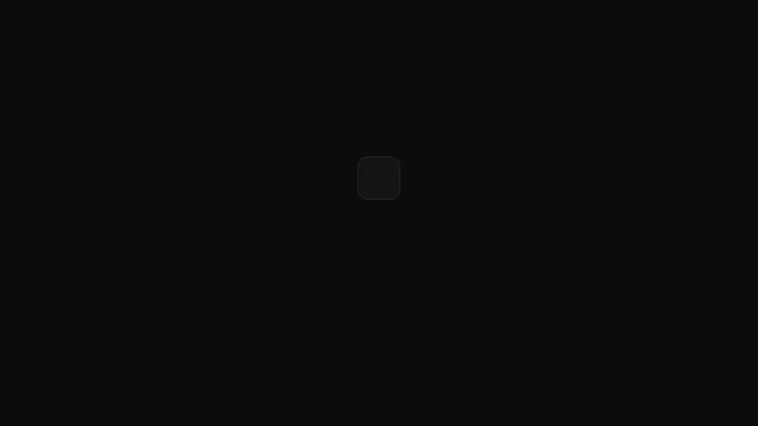
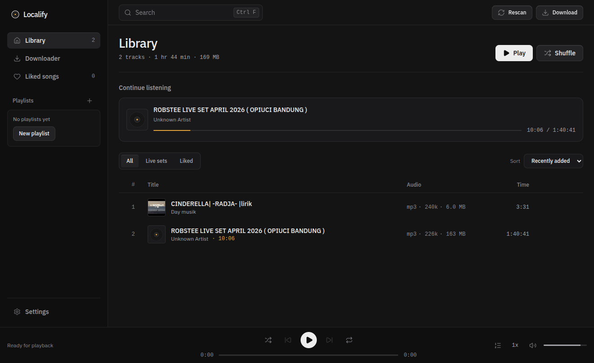

<p align="center">
  
</p>

<h1 align="center">Localify</h1>

<p align="center">
  Offline desktop music player and <code>yt-dlp</code> archiver for Linux — built for local libraries and long DJ live sets.
</p>

<p align="center">
  <a href="https://darkside0908.github.io/localify/">Live Showcase</a> •
  <a href="assets/localify-promo.mp4">Launch Video (MP4)</a> •
  <a href="#quick-start">Quick Start</a> •
  <a href="#keyboard-shortcuts">Shortcuts</a>
</p>

<p align="center">
  
</p>

---

## Why Localify

Streaming the same tracks or 2-hour live sets every day burns mobile hotspot quota and stops working offline. Localify turns your local `~/Music` directory into a calm desktop player with a built-in `yt-dlp` downloader so you download once and listen anywhere without ads or internet.

## Features

- **Offline Library Scanner (`ffprobe` + `ffmpeg`)**: Indexes `.mp3`, `.m4a`, `.opus`, `.ogg`, `.flac`, `.wav`, `.webm`, and `.aac` files, extracts embedded cover art, and skips dotfiles or project subdirectories automatically.
- **Built-in YouTube Downloader (`yt-dlp`)**: Paste one or multiple URLs, import `links.txt`, preview metadata before downloading, choose `MP3`, `M4A`, or `OPUS`, and embed thumbnails, metadata, and chapters cleanly.
- **`--no-playlist` Radio Safeguard**: Detects `&list=` parameters on pasted URLs and keeps single-track mode active by default so YouTube mixes do not accidentally queue dozens of tracks.
- **Auto-Resume & Chapter Navigation**: Saves playback progress for long live sets (`>= 10 min` by default) and renders clickable YouTube chapters plus timeline markers.
- **Local HTTP `206` Media Server**: Streams local files over `127.0.0.1` with session token validation and byte-range seeking for instant scrubbing across large 150MB+ sets.
- **Playlists, Queue & Metadata Editor**: Create custom playlists, favorite tracks, reorder/clear upcoming queue tracks, edit track titles/artists, and control playback via Linux hardware media keys (`MediaSession`).

<p align="center">
  
</p>

## Requirements

- **OS**: Linux (tested on Ubuntu 24.04 LTS Wayland/X11)
- **Node.js**: v20 or newer + `npm`
- **Media tools**: [`yt-dlp`](https://github.com/yt-dlp/yt-dlp), `ffmpeg`, and `ffprobe` (automatically discovered in `~/.local/bin` or `PATH`)

## Quick Start

```bash
git clone https://github.com/Darkside0908/localify.git
cd localify
npm install
npm run build
./launch.sh
```

### Optional: Pin to Ubuntu App Menu / GNOME Dock

```bash
./install-desktop-entry.sh
```

This creates `~/.local/share/applications/localify.desktop` pointing to `launch.sh` and `assets/icon.svg`.

## Keyboard Shortcuts

| Shortcut | Action |
| --- | --- |
| `Space` | Play / Pause |
| `Left` / `Right` | Seek -10s / +10s (`Shift` for ±30s) |
| `Up` / `Down` | Volume +5% / -5% |
| `Ctrl + F` | Focus search bar |
| `Ctrl + D` | Open Downloader view |
| `Escape` | Close open modal |

## Project Structure

```text
localify/
├── electron/         # Main process, preload bridge, ffprobe scanner, yt-dlp queue, HTTP 206 server
├── src/              # React + Tailwind renderer, audio player hook, views & components
├── assets/           # App icon, static screenshot, demo WebP, launch promo MP4
├── promo/            # Deterministic Chromium + ffmpeg launch reel renderer
└── docs/             # Static showcase site for GitHub Pages
```

## Tech Stack

- **Desktop**: Electron, TypeScript
- **Frontend**: React 19, Vite, Tailwind CSS v4, Lucide Icons, `@fontsource/ibm-plex-sans`
- **Media**: `yt-dlp`, `ffmpeg`, `ffprobe`, Node `http` Range server

## License

[MIT](LICENSE) — Copyright (c) 2026 Darkside0908.

The interface follows the [unslop](https://github.com/heydamir/unslop) design workflow by Damir Sokolovsky ([@heydamir](https://x.com/heydamir)), licensed under CC BY 4.0.
